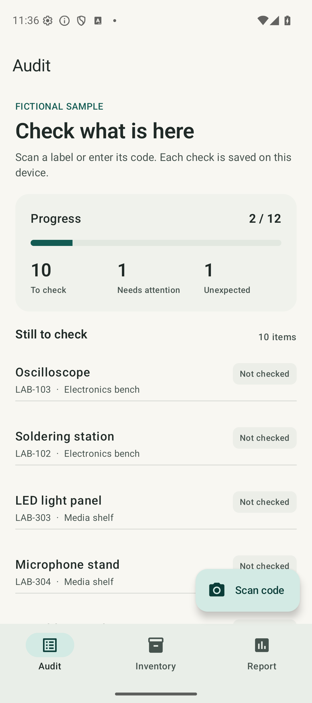
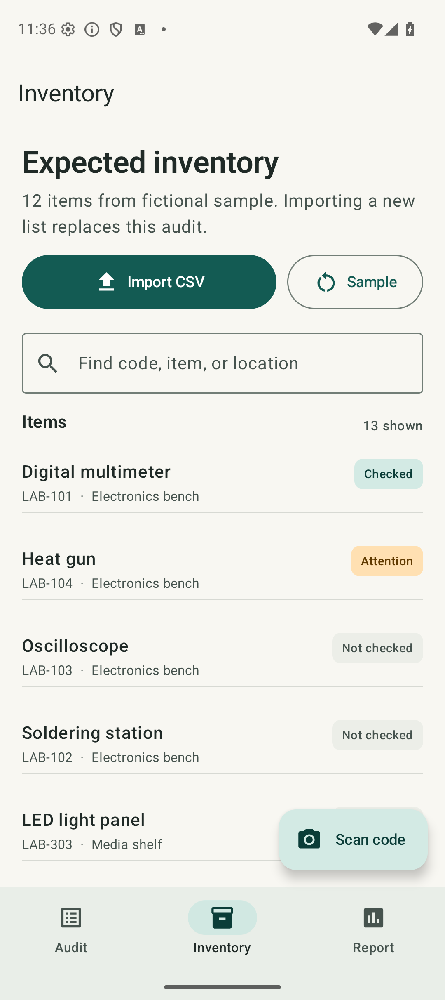
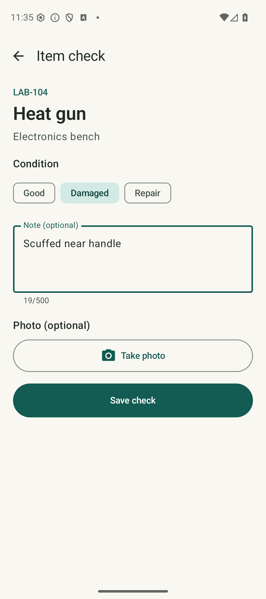
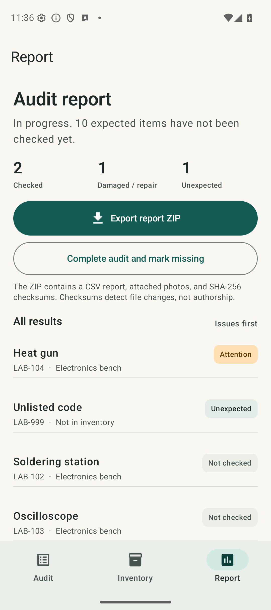

# Pocket Audit

Pocket Audit helps someone check equipment on site against a CSV inventory. Scan a label or type its code, record condition and an optional photo, then export the discrepancies. It works without an account or network connection.

The first launch loads 12 fictional items from a small workshop. The app is usable on an emulator without a camera: enter `LAB-101` on the Scan screen, save it as Good, then try `LAB-202` as Damaged or enter an unlisted code. The Report screen separates these cases and lets you complete the audit. Only then do unchecked expected items become Missing.

## What you can do

- Import a UTF-8 CSV with `code`, `name`, and `location` columns. The parser handles quoted commas, escaped quotes, multiline fields, CRLF, and a UTF-8 BOM. It rejects duplicate or empty codes with a line number. Imports are limited to 5 MiB and 5,000 items.
- Scan QR, Code 128, EAN-13, and EAN-8 labels using CameraX and the bundled ML Kit scanner. Camera permission is optional; manual entry remains available.
- Mark an item Good, Damaged, or Needs repair. Add a note of up to 500 characters and a photo. Scanning the same code again opens its saved check for editing.
- Review checked, attention, unexpected, and not checked items. Completing the audit changes not checked items to missing; reopening reverses that status.
- Export a ZIP with `report.csv`, attached photos, and `manifest.json` containing SHA-256 checksums. Values that could run as spreadsheet formulas are prefixed with an apostrophe in the CSV report. Run `python scripts/verify_export.py report.zip` to check the archive's internal consistency. The manifest is not signed, so it does not prove who made the report.

The app does not request Internet access. Room stores the inventory and observations on the device; photos are in app-private storage. Importing a new list or restoring the fictional sample replaces the current audit after confirmation. Export first if you need to keep an earlier report. Uninstalling the app removes local data.

## Build and try it

Requires JDK 17 or newer and an Android SDK with API 35. Open the project in Android Studio or run:

```bash
./gradlew testDebugUnitTest assembleDebug
```

On Windows, use `gradlew.bat`. Install `app/build/outputs/apk/debug/app-debug.apk` on an emulator or device with Android 8.0 or newer. A [debug APK from the passing CI build](https://github.com/musyase/pocket-audit/releases/download/v0.1.0/pocket-audit-debug.apk) is available in the demo prerelease. It is debug-signed and is not a Play Store package.

To import your own list, start with [`app/src/main/assets/demo_inventory.csv`](app/src/main/assets/demo_inventory.csv). Codes are matched exactly after trimming outer whitespace. Extra CSV columns are ignored. The current version supports one active audit on one device; it has no account, synchronization, OCR, or automatic backup.

## Code to inspect

- [`InventoryCsv`](app/src/main/java/dev/musyase/pocketaudit/domain/InventoryCsv.kt) handles CSV validation and output encoding.
- [`AuditLogic`](app/src/main/java/dev/musyase/pocketaudit/domain/AuditLogic.kt) decides which observations are checked, need attention, unexpected, or missing.
- [`CameraScanner`](app/src/main/java/dev/musyase/pocketaudit/ui/CameraScanner.kt) uses on-device barcode analysis. [`AuditDatabase`](app/src/main/java/dev/musyase/pocketaudit/data/AuditDatabase.kt) holds local state.
- [`ArchiveWriter`](app/src/main/java/dev/musyase/pocketaudit/domain/ArchiveWriter.kt) writes the report and checksums. The Python verifier checks exported files independently.

Unit tests cover quoted and malformed CSV, duplicate codes, the distinction between not checked and missing, unexpected items, and archive contents. An Android instrumented test feeds a generated QR image to the bundled ML Kit decoder; run it on an emulator with `./gradlew connectedDebugAndroidTest`. An exported ZIP containing a camera photo was also checked with the independent verifier. Live scanning on a physical device has not yet been tested. `PRODUCT.md` and `DESIGN.md` record the intended workflow and interface decisions. Screenshots below are captured from the running Android emulator, not mockups.

## Screenshots

Captured on a Pixel 9a emulator with fictional workshop items. The audit shown here has a damaged heat gun, one unlisted code, and ten items still to check.

| Audit | Inventory |
| --- | --- |
|  |  |

| Item check | Report |
| --- | --- |
|  |  |
